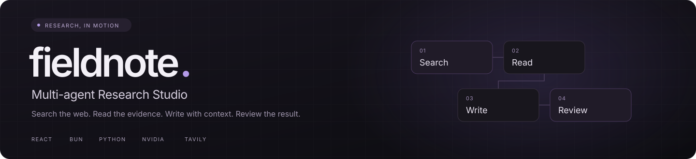
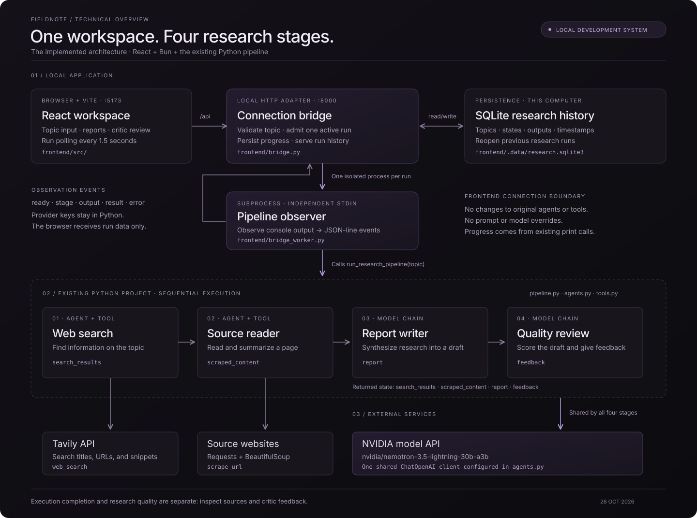
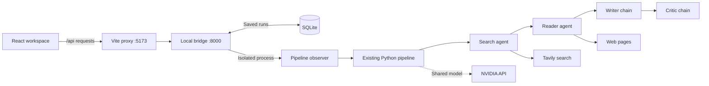

<div align="center">



**A focused workspace for web research, source reading, report writing, and critique.**

[Live app](https://multi-research-agent-pi.vercel.app) · [Quick start](#quick-start) · [Architecture](#architecture) · [Deployment](docs/DEPLOYMENT.md) · [Current limitations](#current-limitations)

</div>

---

## Meet Fieldnote

Fieldnote brings a Python research pipeline into a dark React workspace. Enter a topic, follow each stage, inspect the research, and read the critic's feedback in one place.

The [Vercel deployment](https://multi-research-agent-pi.vercel.app) requires the owner's access code before starting research. Cloud runs stream to the browser, where their history is saved; keep the page open while a run is working.

The project combines **two agents with tools** and **two language-model chains**, executed in sequence. All four stages use the NVIDIA model configured in `agents.py`. Tavily supplies web search; Requests and BeautifulSoup handle page extraction.

The frontend connects through a local adapter inside `frontend/`. Your existing Python pipeline remains the source of research behavior.

| Capability | What you can do |
| :--- | :--- |
| **Research workspace** | Submit a topic from a responsive dark interface with white and grey text. |
| **Stage activity** | Follow search, reader, writer, and critic execution and inspect their output. |
| **Sources** | Open source URLs extracted from the pipeline's returned research text. |
| **Report reader** | Read Markdown reports and switch to the critic's assessment. |
| **Saved history** | Reopen research runs from a compact history menu backed by local SQLite storage. |
| **Export** | Download the report and critic feedback together as Markdown. |
| **Connection status** | See whether the local pipeline is connected, with configuration errors shown beside the input. |

> **Project status:** the UI and local connection are working. The reader preserves source URLs from the search tool and requires a successful page read before report generation. Research quality still needs review; inspect source links and critic feedback. See [current limitations](#current-limitations).

## Quick start

The commands below use **Windows PowerShell**, **Bun**, and **uv** for the Python environment.

### 1. Prepare Python

From the project root, create an environment if you do not already have `.venv`, then install the project dependencies:

```powershell
uv venv .venv
uv pip install --python .venv/Scripts/python.exe -r requirements.txt
```

If `.venv` already exists, skip the first command. The frontend launcher uses this existing environment.

### 2. Configure the providers

Create a `.env` file in the **project root**:

```dotenv
NVIDIA_API_KEY=your_nvidia_api_key
TAVILY_API_KEY=your_tavily_api_key
```

| Setting | Purpose |
| :--- | :--- |
| `NVIDIA_API_KEY` | Authenticates the shared language model used by all four stages. |
| `TAVILY_API_KEY` | Authenticates the web search tool. |

The current model is `nvidia/nemotron-3.5-lightning-30b-a3b`, configured in `agents.py`, with the NVIDIA endpoint `https://integrate.api.nvidia.com/v1`. The frontend reads that configuration without overriding it. Provider keys stay in Python and are not sent to the browser.

### 3. Install and start the frontend

```powershell
cd frontend
bun install
bun run dev
```

Open **[http://127.0.0.1:5173](http://127.0.0.1:5173)**.

This one command starts the React development server on port **5173** and the local connection bridge on port **8000**. Keep the terminal running; press **Ctrl+C** to stop the launcher.

### 4. Explore a topic

Try:

> How do multi-agent AI systems compare with single-agent systems in accuracy, speed, cost, and reliability?

Select **Start research** and follow the four-stage progress strip. Read the inline **Report**, **Review**, and **Sources** tabs; expand **Agent output** to inspect the search and reader text. Previous runs remain available in **History**.

## Architecture



<p align="center">
  <a href="docs/ARCHITECTURE.md"><strong>Read the architecture guide →</strong></a>
</p>



The bridge calls `run_research_pipeline(topic)` in a separate worker. It observes the pipeline's existing console messages, saves outputs, and returns run details to the browser. It does not replace the agents, tools, prompts, or pipeline logic. The diagram's shared NVIDIA connection represents model use by all four stages.

## Research workflow

| Stage | Implementation | Input | Output |
| :--- | :--- | :--- | :--- |
| **01 · Search** | Agent + `web_search` | Research topic | `search_results` |
| **02 · Read** | Agent + `scrape_url` | Topic, explicit source URLs, and the search results | `scraped_content`, including successful page excerpts |
| **03 · Write** | Prompt → model → string parser | Topic, search summary, and reader output | `report` |
| **04 · Critique** | Prompt → model → string parser | Writer output | `feedback`, including a requested score out of 10 |

The pipeline returns those four text fields. Search tool records are preserved alongside the search summary. The reader must return a successful `scrape_url` result, and the pipeline includes that page text in the writer's research context. The frontend bridge derives source links, word count, and critic score from the returned text. Stage completion does not certify factual quality.

## Project map

```text
multi-agent-system/
├── agents.py                 # NVIDIA model, two agents, writer and critic chains
├── tools.py                  # Tavily search and page extraction tools
├── pipeline.py               # Sequential orchestration and CLI entry point
├── requirements.txt          # Existing Python dependencies
├── .env                      # Local provider credentials; not committed
├── README.md
├── docs/
│   ├── ARCHITECTURE.md        # Components, contracts, lifecycle, and limitations
│   └── assets/               # README banner and architecture artwork
└── frontend/
    ├── src/                  # React views, API client, and polling state
    ├── bridge.py             # Local HTTP adapter and SQLite persistence
    ├── bridge_worker.py      # Observer around the existing pipeline
    ├── dev.js                # Bun launcher for UI and connection bridge
    ├── vite.config.js        # Local /api proxy
    ├── package.json
    ├── bun.lock
    ├── tests/                # Bridge and original-pipeline compatibility checks
    └── .data/                # Local research history; ignored by frontend Git rules
```

## Commands

| Command | Run from | Purpose |
| :--- | :--- | :--- |
| `bun install` | `frontend/` | Install frontend packages. |
| `bun run dev` | `frontend/` | Start the UI and local bridge together. |
| `bun run dev:ui` | `frontend/` | Start Vite only. |
| `bun run build` | `frontend/` | Generate the frontend production bundle in `frontend/dist/`. |
| `bun run preview` | `frontend/` | Preview the built UI; the bridge must also be running. |
| `.\.venv\Scripts\python.exe -B pipeline.py` | Project root | Run the original terminal workflow. |
| `.\.venv\Scripts\python.exe -B frontend/bridge.py` | Project root | Start the connection bridge separately in an interactive terminal. |

## Local API

For cloud hosting, see the [Vercel deployment guide](docs/DEPLOYMENT.md). The cloud adapter streams the same pipeline and keeps history in the browser; the local API below uses SQLite and polling.

The React app uses relative `/api` requests. Vite forwards them to the bridge at `127.0.0.1:8000`.

| Method | Endpoint | Purpose |
| :--- | :--- | :--- |
| `GET` | `/api/health` | Configuration presence and model name. |
| `POST` | `/api/research` | Create a run; returns `202` with a run ID. |
| `GET` | `/api/research` | List up to 100 recent saved runs. |
| `GET` | `/api/research/{id}` | Read a run's stages, outputs, and metadata. |

Create request:

```json
{
  "topic": "How do multi-agent AI systems compare with single-agent systems?"
}
```

Topics must contain **3–1,000 characters** after trimming. One research run can execute at a time; a second submission receives `409`. The UI polls selected runs every **1.5 seconds** and refreshes connection status and history every **5 seconds**.

## Checks

From the project root:

```powershell
.\.venv\Scripts\python.exe -B -m unittest discover -s frontend/tests -v
```

The connection and reader checks cover request validation, credential redaction, history persistence, interrupted runs, pipeline compatibility, real worker startup, URL preservation, failed scraping, and text decoding. External provider calls are substituted during these checks; passing them does not establish research quality.

For the UI build:

```powershell
cd frontend
bun run build
```

## Current limitations

- **Source availability:** websites can block scraping or return errors. The reader is prompted to try another listed source; a run stops if no successful page read is returned.
- **Reader context:** page excerpts are limited to 3,000 characters each. JavaScript-rendered pages, paywalls, and binary documents are not fully supported by the HTML scraper.
- **Execution versus quality:** the pipeline now checks that the reader actually retrieved content, but that alone does not establish factual correctness or a strong final report. Inspect the source list and critic feedback.
- **Startup behavior:** importing the existing `tools.py` performs a web search. The worker suppresses its startup console text, but the original search still executes.
- **Source metadata:** source links are extracted from returned text. The original pipeline does not expose a structured source record or an exact count of successfully scraped pages.
- **Local service:** the current bridge has one worker, a local database, and no user authentication. It is designed for use on the same computer.

<details>
<summary><strong>Reader diagnosis and fix · October 26, 2026</strong></summary>

Before the fix, the comparison topic completed all four calls while the reader requested links and the critic scored the output **2/10**. Investigation reproduced discarded tool URLs, 800-character truncation, HTTP error pages treated as content, and text-decoding problems. The approved fix preserves actual search-tool URLs, rejects HTTP errors, extracts readable page content, and requires a successful reader tool result before the writer runs.

The subsequent live run retrieved four pages, skipped an unreadable Galileo page, and produced a 1,015-word report with a critic score of **6/10**. This verifies page retrieval and the full execution flow; the critic still identifies research-quality limitations.

</details>

## Troubleshooting

| Symptom | What to check |
| :--- | :--- |
| UI cannot reach the project | Start `bun run dev` from `frontend/` and confirm both ports 5173 and 8000 are available. |
| Launcher cannot find Python | Confirm the project root contains `.venv` with the existing Python dependencies installed. |
| Configuration required | Add both provider keys to the root `.env` file and restart the launcher. |
| NVIDIA capacity error | Wait and use **Retry research**. The bridge displays the provider failure. |
| Reader could not read a source | Inspect its error, then retry with a topic that has accessible web sources. Report generation stops when every page read fails. |
| Run was interrupted | Restarting the bridge marks unfinished runs as failed. Start a new run to retry. |

---

<div align="center">
  <strong>Ask a better question. Inspect the evidence. Keep the useful insight.</strong><br />
  <sub>Fieldnote · Multi-agent Research Studio</sub>
</div>
