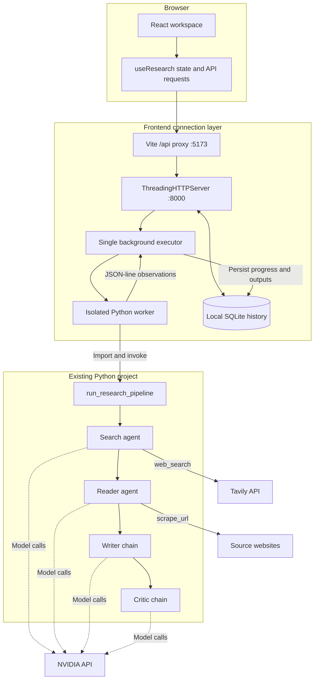
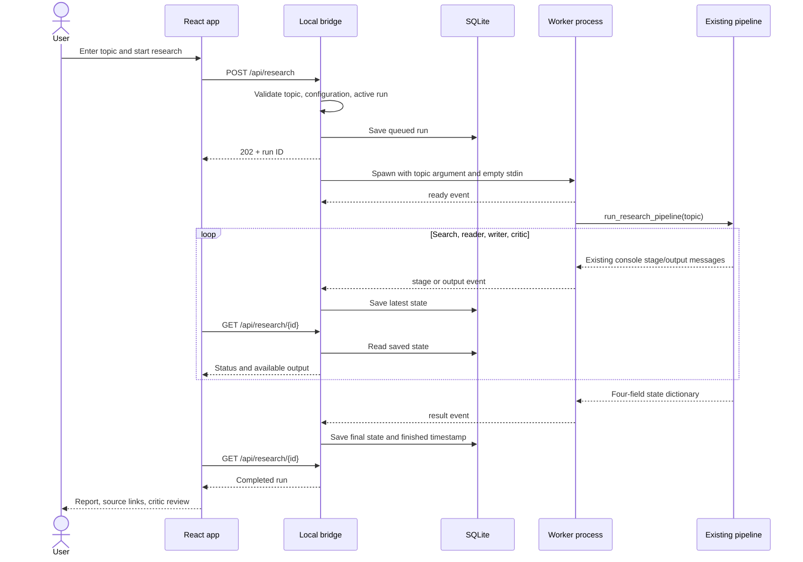
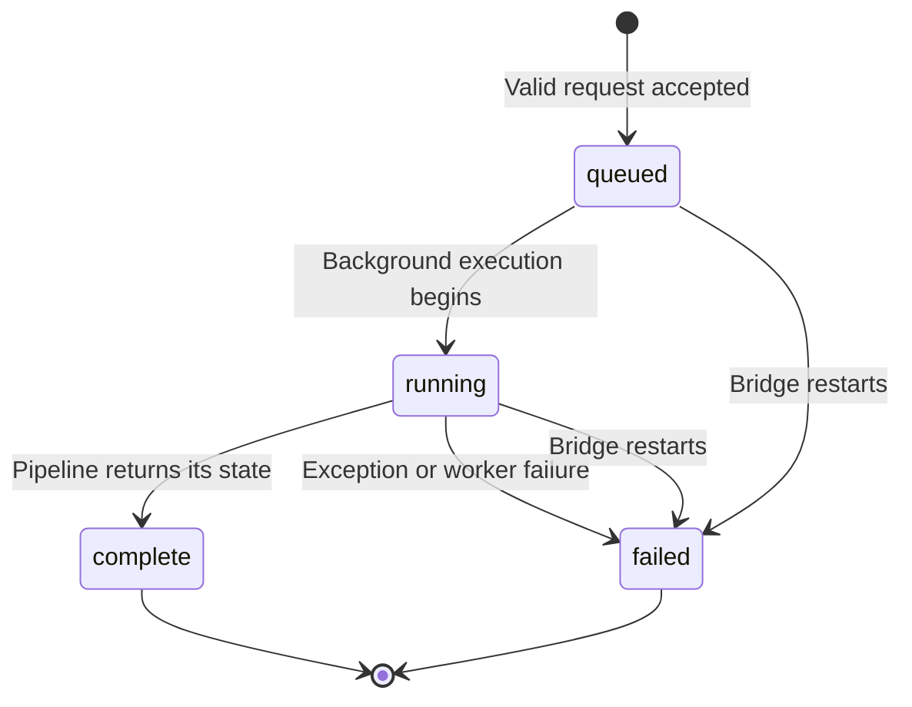

# Fieldnote architecture

This guide describes the implemented system as of **October 26, 2026**. It separates the React workspace and connection adapter from the existing Python research code. Suggested improvements are identified at the end; they are not implemented by this documentation change.


[Open the vector diagram](assets/architecture.svg) · [Download the PNG](assets/architecture.png)

## 1. System boundaries

| Boundary | Components | Responsibility |
| :--- | :--- | :--- |
| Browser | React, `App.jsx`, `useResearch.js` | Topic entry, history selection, polling, inline report/review/source tabs, export. |
| Local development server | Vite, `vite.config.js` | Serve the UI and proxy `/api` requests to port 8000. |
| Frontend connection adapter | `bridge.py` | Validate requests, admit one active run, start a worker, persist state, expose local HTTP endpoints. |
| Worker process | `bridge_worker.py` | Call the existing pipeline and translate observed console messages and returned state into JSON-line events. |
| Existing Python project | `pipeline.py`, `agents.py`, `tools.py` | Define orchestration, prompts, model calls, web search, and extraction behavior. |
| External services | NVIDIA, Tavily, source websites | Generate model responses, return search results, and serve page content. |
| Local persistence | `frontend/.data/research.sqlite3` | Store run state and outputs for reopening in the UI. |

The adapter does not monkeypatch the existing Python modules. Model selection and prompts remain owned by `agents.py`; tool behavior remains owned by `tools.py`; execution order remains owned by `pipeline.py`.

## 2. Component graph



The graph expresses a sequential research workflow. The agents do not execute in parallel. The HTTP server can answer UI requests while the single background executor waits for the worker.

## 3. Request and execution sequence



### Worker startup

The worker receives the topic as a process argument. Its stdin is connected to `subprocess.DEVNULL`; stdout carries JSON-line events, and stderr goes to a temporary error file.

The independent stdin is deliberate. The bridge reads its own input pipe for launcher shutdown messages. Inheriting that same pipe previously blocked Windows Python during standard-stream initialization. The adapter now isolates the worker's input and emits a `ready` event before importing the original pipeline.

The worker uses Python's `-B` option to avoid writing bytecode while loading the existing project.

## 4. Pipeline contract

The original entry point is:

```python
run_research_pipeline(topic: str) -> dict
```

The dictionary contains:

| Field | Produced by | Used by |
| :--- | :--- | :--- |
| `search_results` | Search agent's final message plus original web search tool records | Reader, writer, frontend source extraction. |
| `scraped_content` | Reader agent's final message plus successful page excerpts and URLs | Writer and agent-output disclosure. |
| `report` | Writer chain | Critic, report viewer, Markdown export. |
| `feedback` | Critic chain | Review viewer and score extraction. |

### Important constraints

- Search exposes up to five Tavily results to its agent, including each result's title, URL, and the first 300 characters of its content.
- The search agent's final answer is free-form text. The pipeline also retains the actual `web_search` tool messages and extracts their explicit URL records. A run fails if no usable source URLs are returned by the tool.
- The reader receives explicit source URLs followed by the search results. The previous 800-character truncation has been removed.
- The reader is prompted to invoke `scrape_url` and try another listed source after a failed request. The pipeline requires at least one successful reader tool result before starting the writer.
- The scraper requests a page with an 8-second timeout, checks HTTP status, parses the response bytes to preserve text encoding, removes several non-content tags, and prefers the main/article content. It returns up to 3,000 characters and converts caught exceptions to an error string.
- The writer requests an introduction, at least three key findings, a conclusion, and source URLs.
- The critic requests a score out of ten, strengths, areas to improve, and a one-line verdict.

Reader success is checked against tool messages rather than the final summary alone. This establishes that page content was returned, but does not certify its factual accuracy or quality.

## 5. Observation protocol

The worker observes the pipeline's existing print calls and sends one JSON object per stdout line:

| Event | Meaning | Bridge action |
| :--- | :--- | :--- |
| `ready` | Worker script initialized. | Record `worker_started_at`. |
| `stage` | A known stage-start message was printed. | Mark earlier stages complete; start the observed stage. |
| `output` | A known stage-output print was observed. | Persist text and derive display metadata. |
| `result` | The original pipeline returned its state. | Persist final fields and mark execution complete. |
| `error` | The worker caught an exception. | Record the error, mark the run failed, and mark any running stage failed. |

This is an adapter to a console-oriented pipeline, not a native pipeline event API. Renaming its printed stage or output markers can break intermediate progress display. The final returned dictionary is still needed to populate final output.

The original `tools.py` performs an import-time web search. Its console text is suppressed by the observer before stage observation begins; the actual network call remains part of the existing module's behavior.

## 6. Run lifecycle and persistence



**`complete` describes execution, not research quality.** The inspected live run finished all four calls while its report lacked research and its critic score was 2/10.

The SQLite `runs` table stores the run ID, creation time, and a JSON payload. That payload contains the topic, stage timestamps, execution status, original outputs, derived source links, score, word count, and any error. State is saved as events arrive, so earlier observed outputs can survive a later failure.

Recent-history queries return at most 100 runs. Startup recovery uses that same recent-run listing to mark unfinished runs as failed. A retry creates a new run; there is no stage-level resume operation.

The browser saves the selected run ID in local storage when available. Provider credentials and full research history are not stored there.

## 7. HTTP and frontend contracts

| Endpoint | Success | Relevant errors |
| :--- | :--- | :--- |
| `GET /api/health` | `200`; status, missing variable names, model name | `ready` indicates configuration presence, not a successful provider request. |
| `POST /api/research` | `202`; new queued run | `422` for an invalid topic, `409` for another active run, `503` for missing keys. |
| `GET /api/research` | `200`; recent run summaries | No pagination beyond the current 100-run limit. |
| `GET /api/research/{id}` | `200`; saved run detail | `404` if the run does not exist. |

Selected-run polling runs every 1.5 seconds and stops after a terminal status. Connection and history refresh every 5 seconds. Changing the selected run aborts its prior fetch context. The default frontend request timeout is 15 seconds; that HTTP timeout does not cancel research running in the worker.

Source URLs are derived from the search answer and report. They are not a complete tool-execution audit. The original pipeline does not provide an exact scraped-page count, so new reader completions display “Source analysis ready.”

## 8. Configuration and local boundaries

- The bridge binds to `127.0.0.1:8000`; Vite serves the UI at `127.0.0.1:5173`.
- The bridge and existing Python code load the project root `.env`.
- All four model stages use `NVIDIA_API_KEY`; Tavily uses `TAVILY_API_KEY`.
- The current model name is read from the literal model configuration in `agents.py` without importing that module for health checks.
- Provider keys are not returned in the API. Known configured key values are removed from error messages before display.
- Search queries go to Tavily. Model prompts and research context go to NVIDIA. Scraping requests go to source websites.
- There is no login, tenancy model, distributed queue, or production deployment boundary in the current local adapter.

## 9. Verification boundaries

`frontend/tests/test_bridge.py` covers HTTP validation and configuration handling, credential redaction, persistent results, restart recovery, pipeline event compatibility, exception propagation, and actual subprocess startup with an independent input stream. `frontend/tests/test_reader_pipeline.py` covers preserving tool URLs, late URLs and parentheses in URLs, rejecting failed or absent reader tool results, HTTP errors, and Unicode extraction.

The checks execute the original pipeline with substituted external components and use temporary storage. They establish adapter compatibility; they do not assert the factual quality of live model output or the availability of external services.

## 10. Proposed next architecture improvements

These are design recommendations only. Implementing them would require a separate change to the existing pipeline or its contracts.

| Priority | Improvement | Benefit |
| :--- | :--- | :--- |
| First | Carry structured source records with explicit URLs between search and reader. | Removes dependence on URLs surviving a free-form search summary. |
| Next | Validate final report substance and citation coverage in addition to the implemented reader checks. | Identifies weak reports after successful page retrieval. |
| Next | Replace console observation with typed progress events. | Keeps the adapter independent of print formatting. |
| Next | Distinguish execution status from evidence and quality status. | Makes “finished” and “usable research” separately visible. |
| Later | Add provider timeouts, bounded retries, and stage recovery. | Makes external failures easier to manage without repeating completed work. |
| If deployment expands | Add authentication, durable job ownership, and a queue. | Supports multiple users or machines beyond the current local service. |

The approved reader fix now preserves actual tool URLs and checks successful page reads. A typed source-record contract and explicit evidence/quality status would further improve the current text-based interface.
