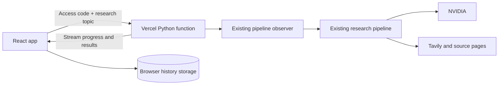

# Vercel deployment

The repository supports both the original local application and a Vercel deployment. Both call the same research pipeline, agents, and tools.

## Runtime layout



`vercel.json` builds the React app using Bun and deploys `api/research.py` as a Python function. The function uses the existing pipeline observer and the same state-processing helpers as the local bridge. It sends newline-delimited JSON snapshots as stages finish.

## Environment variables

Configure these in the Vercel project's **Production** environment:

| Variable | Purpose |
| :--- | :--- |
| `NVIDIA_API_KEY` | Existing NVIDIA model credentials. |
| `TAVILY_API_KEY` | Existing Tavily search credentials. |
| `RESEARCH_ACCESS_KEY` | Private access code required to start cloud research. |

Provider keys are never included in the frontend bundle. The deployment access code is entered by the owner and retained in the current browser tab's session storage. The server checks it before invoking the pipeline. Unauthenticated research requests receive HTTP 401.

The generated owner code is stored locally in `.vercel/research-access.txt`. That directory, `.env`, local history, dependencies, and build output are excluded from source uploads and version control as appropriate. Do not publish the access code.

## Deploy

With the Vercel CLI signed in, run from the repository root:

```powershell
bunx vercel@latest link --project multi-research-agent
bunx vercel@latest deploy --prod
```

The install and build commands are configured in `vercel.json`:

```powershell
bunx bun@1.4.2 install --cwd frontend --frozen-lockfile
bunx bun@1.4.2 run --cwd frontend build
```

Environment changes require a new deployment before they become available to that deployment's functions.

## Local and cloud behavior

| Behavior | Local app | Vercel deployment |
| :--- | :--- | :--- |
| Execution | Bridge starts a worker subprocess. | Python function runs the observer during the HTTP request. |
| Progress | Poll the local bridge. | Receive streamed run snapshots. |
| History | SQLite on this computer. | Up to 30 runs in this browser's local storage. |
| Closing the page | Local worker continues. | Results cannot be resumed through the closed connection. Keep the page open. |
| Restart/reload | Bridge records interrupted runs. | Saved partial cloud runs are marked interrupted. |
| Access code | Not required. | Required before research can start. |

The cloud function is configured with a **300-second** maximum duration, and the client stops waiting just before that limit. Runs exceeding the limit retain the partial snapshots already saved in the browser. A narrower topic can reduce run time. Cross-device history and durable background jobs require a separate storage/job service.

The local app still starts with `bun run dev` from `frontend/`.

## Checks

```powershell
.\.venv\Scripts\python.exe -B -m unittest discover -s frontend/tests -v
```

Cloud checks cover access-code enforcement, secret redaction, stage snapshots, streamed completion, and failure handling without calling external providers. Validate the deployed `/api/health`, unauthenticated request rejection, and a real research run after deployment.
